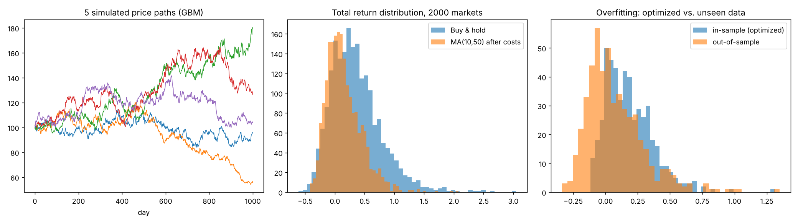
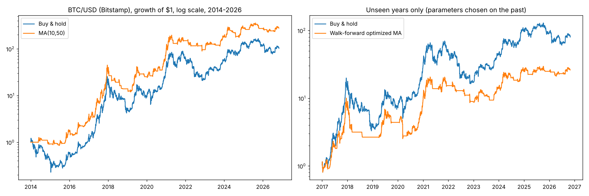

# Does a Simple Trend-Following Strategy Have an Edge? A Monte Carlo and Real-Data Backtest on Bitcoin

A small, reproducible study of one question: **does a moving-average crossover strategy beat buy-and-hold after costs, and how much of an apparent edge disappears when parameters are tuned on past data?**

The study has two parts:

1. **Monte Carlo experiment** on simulated random-walk markets (no real edge exists by construction).
2. **Backtest on real BTC/USD daily data** (Bitstamp, 2014-2026), including a walk-forward test that separates tuning data from unseen data.

> This is an educational study, not investment advice. See [Limitations](#limitations).

---

## Summary of findings

- On simulated random-walk prices, the crossover strategy **underperformed buy-and-hold** and lost money in about a third of markets. Optimizing its parameters on past data made it look good in-sample and clearly worse on unseen data (**overfitting**).
- On real Bitcoin data, the same simple strategy showed a **modest risk-adjusted advantage** (higher Sharpe ratio, smaller maximum drawdown) with roughly equal return to buy-and-hold on the walk-forward period. This is consistent with the idea that trending behavior exists in crypto markets.
- **Re-optimizing parameters every year on the previous three years made results worse**, not better. In-sample numbers were extreme (for example +4939% on the training window before 2018) while the following unseen year lost 63%.
- Even the better strategy had a maximum drawdown of about 73%. A strategy that is statistically "better" can still be unusable for many investors.

---

## Method

### Strategy

Long-only moving-average crossover on daily closes.

- Signal: hold the asset when the fast simple moving average is above the slow one, otherwise hold cash.
- **No look-ahead:** the signal computed at day *t* is traded on day *t+1*.
- **Costs:** 0.1% of position value for every change in position (buy or sell).
- Benchmark: buy-and-hold of the same asset.

### Experiment 1: Monte Carlo on random-walk markets

- 2,000 independent price paths, 1,000 days each (about 4 years).
- Geometric Brownian motion with daily drift 0.03% and daily volatility 1%.
- Strategy: MA(10, 50).
- Overfitting test (500 paths): for each path, choose `(fast, slow)` from a grid on the first 500 days, then trade the last 500 days with the chosen parameters. Grid: fast in {5, 10, 15, 20}, slow in {30, 50, 80, 120}, fast < slow.

### Experiment 2: Real BTC/USD data

- **Data:** Bitstamp BTC/USD, built from public 1-minute candles into daily closes (UTC). Source repository: [ff137/bitstamp-btcusd-minute-data](https://github.com/ff137/bitstamp-btcusd-minute-data).
- Period used: 2014-01-01 to 2026-10-31 (4,687 daily candles; price from about $755 to about $77,315). Earlier, illiquid years were excluded.
- **Fixed strategy:** MA(10, 50) over the whole period.
- **Walk-forward test:** for each calendar year from 2017, choose `(fast, slow)` from a grid using only the previous 3 years, then trade that year with the chosen parameters. Grid: fast in {5, 10, 20, 30}, slow in {50, 100, 150, 200}, fast < slow. The yearly results are stitched into one out-of-sample series.
- Metrics: total return, CAGR, maximum drawdown, annualized Sharpe ratio (365 days, zero risk-free rate).

---

## Results

### Experiment 1: simulated markets

| Strategy | Mean total return | Median total return |
|---|---|---|
| Buy and hold | 35.3% | 29.2% |
| MA(10, 50), after costs | 14.9% | 9.5% |

- MA(10, 50) beat buy-and-hold in **22.7%** of simulated markets and lost money in **34.8%**.

Parameter optimization (first half in-sample, second half unseen):

| | Mean return, in-sample | Mean return, unseen half |
|---|---|---|
| Optimized MA | 18.3% | 7.5% |
| Buy and hold | 16.1% | 15.8% |

The optimized strategy beat buy-and-hold on the unseen half in only **28.2%** of paths.



### Experiment 2: real Bitcoin data

Whole period, 2014-2026:

| Strategy | Total return | CAGR | Max drawdown | Sharpe |
|---|---|---|---|---|
| Buy and hold | 10,142% | 43.4% | -83.4% | 0.87 |
| MA(10, 50) | 27,728% | 55.0% | -73.4% | 1.16 |

Walk-forward, unseen years 2017-2026:

| Strategy | Total return | CAGR | Max drawdown | Sharpe |
|---|---|---|---|---|
| Buy and hold | 7,901% | 56.1% | -83.4% | 1.00 |
| MA(10, 50), fixed | 7,914% | 56.1% | -73.4% | 1.15 |
| MA, re-optimized yearly on past 3 years | 2,517% | 39.3% | -74.9% | 0.89 |

Year by year (the in-sample column is the return of the chosen parameters on the 3-year training window):

| Year | Chosen (fast, slow) | In-sample return | Optimized, unseen year | MA(10, 50) | Buy and hold |
|---|---|---|---|---|---|
| 2017 | (20, 50) | 278% | 626% | 834% | 1,336% |
| 2018 | (10, 150) | 4,939% | -63% | -57% | -73% |
| 2019 | (30, 150) | 2,013% | 65% | 82% | 94% |
| 2020 | (30, 100) | 1,498% | 113% | 254% | 304% |
| 2021 | (5, 150) | 471% | 64% | 67% | 59% |
| 2022 | (30, 50) | 1,597% | -43% | -36% | -64% |
| 2023 | (5, 100) | 435% | 60% | 89% | 156% |
| 2024 | (5, 150) | 89% | 78% | 51% | 121% |
| 2025 | (5, 150) | 203% | 0% | 0% | -6% |
| 2026 (to Oct 31) | (5, 50) | 166% | 5% | 2% | -12% |

The optimized strategy beat buy-and-hold in 5 of 10 unseen years (2018, 2021, 2022, 2025, 2026), mostly by staying out of the market during declines, and lagged in strong bull years.



---

## Interpretation

- **Random markets offer no free lunch.** When prices are a random walk, a trend rule only adds costs and misses part of the drift. Any apparent edge from tuning is noise.
- **Real crypto prices behaved differently** over this sample: the trend rule reduced drawdowns and improved the Sharpe ratio without sacrificing return. This is one asset and one historical path, so it is evidence, not proof.
- **In-sample performance is a poor guide.** The largest in-sample returns came with the worst unseen-year outcomes. Always evaluate on data that was not used to choose the parameters.
- **Risk matters as much as return.** A drawdown of roughly 70-80% is not a small detail.

---

## Limitations

- **One asset, one history.** Bitcoin's 2014-2026 history is dominated by a very large long-term uptrend. Results may not transfer to other assets or future periods.
- **MA(10, 50) was chosen before looking at the real data** (it was the default in the simulation), but it was the only fixed combination evaluated on the full period, and 12 years of daily data is a limited sample. Conclusions about it are tentative.
- **Simplified costs:** a flat 0.1% per position change. Slippage, bid-ask spread, funding, taxes, and exchange fees that vary by tier are not modeled.
- **Long-only, fully invested or in cash;** no leverage, shorting, or position sizing.
- **Data quality:** daily closes are derived from a third-party repository of Bitstamp 1-minute data. Minutes without trades are forward-filled. The data was not independently verified against another source.
- **2026 is a partial year.**
- No statistical significance tests or confidence intervals are reported.

---

## Reproduce

Requirements: Python 3, `numpy`, `pandas`, `matplotlib`.

```bash
# Part 1: Monte Carlo (no data needed)
python3 strategy_montecarlo.py

# Part 2: real data
mkdir data
# Download from https://github.com/ff137/bitstamp-btcusd-minute-data :
#   data/historical/btcusd_bitstamp_1min_2012-2025.csv.gz  -> data/hist.csv.gz
#   data/updates/btcusd_bitstamp_1min_latest.csv           -> data/latest.csv
python3 real_data_backtest.py data .
```

The second script also writes `btc_daily_bitstamp.csv` (the daily closes used) and `real_data_results.png`.

### Repository layout

```
.
├── README.md
├── strategy_montecarlo.py     # Monte Carlo experiment
├── real_data_backtest.py      # real-data and walk-forward backtest
├── btc_daily_bitstamp.csv     # derived daily closes (2014-2026)
├── montecarlo_results.png
└── real_data_results.png
```

---

## Possible extensions

- Repeat on other assets (ETH, equity indices, gold) and across exchanges.
- Test a grid of fixed parameters and report the whole distribution instead of one setting.
- Add bootstrap or block-bootstrap confidence intervals for the Sharpe ratio difference.
- Model slippage and spread; test sensitivity to the cost assumption.
- Add volatility-based position sizing and compare drawdowns.

---

## Note on authorship

Written by Ahmad Jafari Aghdam. Code and analysis were developed with assistance from an AI model (Claude, by Anthropic); all results were produced by running the included scripts.
